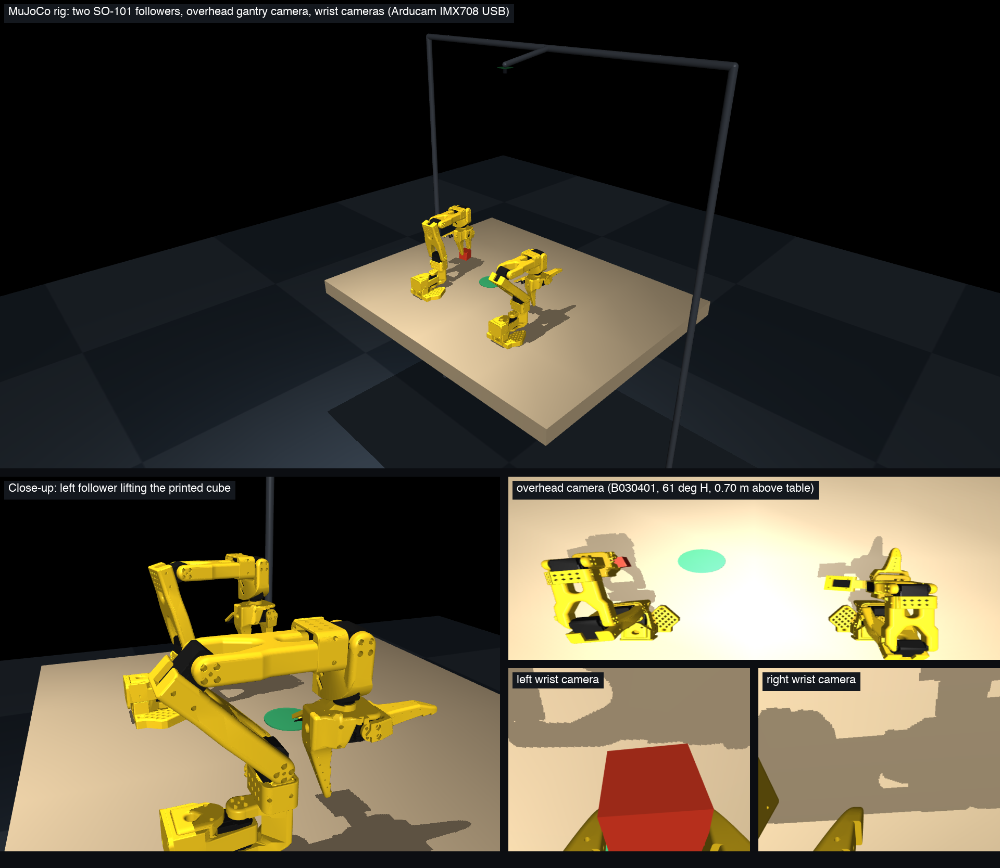
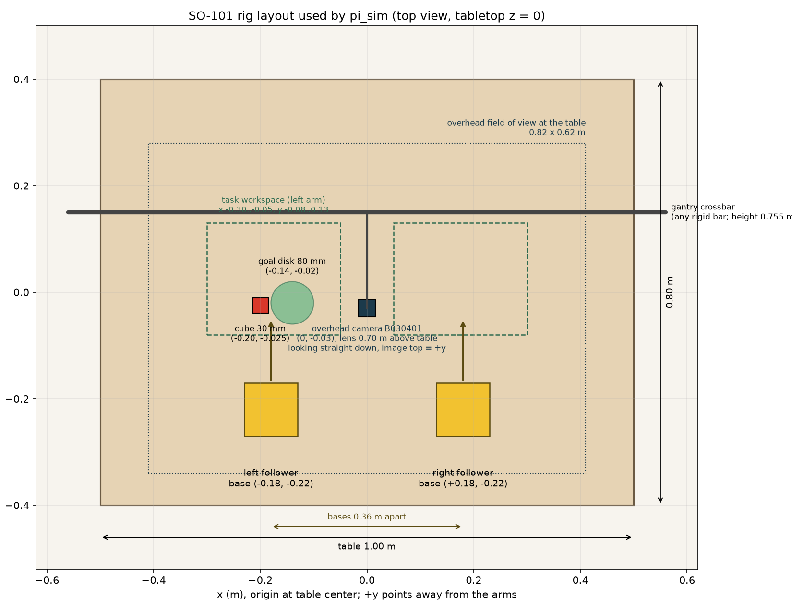

# Replicating the rig

Two SO-101 follower arms on one table, an overhead camera on a gantry, one camera
on each wrist. The simulator in this repository is this exact layout, so a rig built
to these numbers produces data that matches the simulated one.





## 1. Parts

| Part | Qty | Exact item |
| --- | --- | --- |
| SO-101 arm, leader + follower electronics | 1 kit (2 for bimanual teleop) | Seeed Studio "SO-101 Low-Cost AI Arm Kit Pro" (12 V follower servos, 7.4 V leader servos, bus adapter boards, cables, power supplies). Alternatives with the same geometry: Hiwonder SO-ARM101 kit, MakerMods SO-101, Robonine SO-ARM101. It must be SO-**101**, with Feetech STS3215 servos. |
| Second follower for the bimanual rig | 1 | 6 × STS3215 12 V (ST3215-C047), 1 Waveshare bus servo adapter, 1 × 12 V 5 A supply, or a second Seeed kit |
| Printed arm parts | 1 set per arm | Seeed "SO-101 3D-printed parts", or print [TheRobotStudio/SO-ARM100](https://github.com/TheRobotStudio/SO-ARM100) in PLA+, 0.4 mm nozzle, 0.2 mm layers, 15% infill, supports everywhere except slopes over 45° |
| Cameras | 3 + 1 spare | **Arducam B030401**: 12 MP Sony IMX708 (the Raspberry Pi Camera Module 3 sensor) on a USB 2.0 UVC adapter, autofocus 10 cm to infinity, 75° diagonal lens (61° horizontal, 50° vertical), 32 × 32 mm board. Not the fixed-focus wide B0305: it focuses from 1.5 m and cannot see a grasp. |
| Wrist camera mounts | 2 printed | [SO101 32×32 UVC hex-nut wrist mount](https://github.com/TheRobotStudio/SO-ARM100/tree/main/Optional/SO101_Wrist_Cam_Hex-Nut_Mount_32x32_UVC_Module): 2 × M3×8 with nuts, 4 × M2 |
| Overhead gantry | 1 | Any rigid bar whose underside is 0.755 m above the tabletop with the camera board screwed to it lens-down (2020 aluminium extrusion: one 1.2 m crossbar, two 0.8 m uprights, four corner brackets, two table clamps), or the [official overhead mount](https://github.com/TheRobotStudio/SO-ARM100/blob/main/Optional/Overhead_Cam_Mount_Webcam/README.md) raised to that height |
| Table | 1 | Any table at least 1.0 × 0.8 m; the sim's table is 1.0 × 0.8 m |
| Objects | 4 colors | Print `printables/cube_30mm.stl`, `cylinder_30mm.stl` and `goal_disk_80mm.stl` in matte red, green, blue and yellow PLA |
| Powered USB 3.0 hub | 1 | 7 ports: two serial adapters and three cameras |
| Lighting and background | 1 each | Fixed LED panel, plain matte tablecloth or mat |

## 2. Geometry (measure from the table center, tabletop is z = 0)

| Item | Position | Orientation |
| --- | --- | --- |
| Left follower base plate center | x = −0.18 m, y = −0.22 m | Arm reaches toward +y (away from the operator) |
| Right follower base plate center | x = +0.18 m, y = −0.22 m | Same |
| Overhead camera optical center | x = 0, y = −0.03 m, z = +0.70 m | Looking straight down; image top toward +y, image right toward +x |
| Wrist cameras | In the printed wrist-roll mount | Lens behind and above the fingertips, as in the MuJoCo Menagerie SO-101 model |
| Cube start, goal disk | (−0.20, −0.025), (−0.14, −0.02) nominal | The recorder randomizes these over the left arm's workspace |

Clamp the bases so the two plates are 0.36 m apart and square to the table edge.
Place the gantry crossbar behind the camera (y ≈ +0.15 m) so no bar enters the
overhead view. At 0.70 m the overhead camera sees 0.82 × 0.62 m of tabletop,
which covers both workspaces and both bases.

## 3. Electronics and calibration

1. Assemble per the [LeRobot SO-101 guide](https://huggingface.co/docs/lerobot/en/so101): set motor IDs 1–6 on each arm (`lerobot-setup-motors`), then calibrate (`lerobot-calibrate`). Keep the JSON calibration files; `pi_observe` checks them against the servos.
2. Plug the three cameras into the hub. Set every camera to 640×480, 30 fps, MJPG. Lock the overhead camera's focus with the UVC focus control; leave the wrists on autofocus. Fix exposure and white balance.
3. Copy `configs/so101_observe.example.json` to `configs/so101_observe.local.json`; fill the two serial ports, the two calibration paths and the three camera device IDs in the order overhead, left wrist, right wrist.
4. Calibrate each camera's intrinsics with a checkerboard at 640×480 at its working focus distance (overhead at 0.70 m, wrists at about 0.12 m). Copy `pi_sim/assets/so101_camera_rig.json` to `configs/so101_camera_rig.local.json` and write fx, fy, cx, cy and the five distortion coefficients per camera; set `calibration_status` to `measured`.

## 4. Software

```bash
git clone <this repository> pi && cd pi
conda create -n pi-sim python=3.11 -y && conda activate pi-sim
pip install -e '.[model,capture,data]'        # MuJoCo, PyTorch, cameras, datasets

./play.sh --demo --task pick_place            # watch the simulated rig
python scripts/render_setup.py                # outputs/mujoco_setup.png, the image above
python -m pi_observe sim                      # three simulated camera captures
python -m pi_observe robot --config configs/so101_observe.local.json   # the same from hardware
```

Compare the physical `overhead.png` with the simulated one at the same arm pose:
the bases, disk and cube should land on the same pixels to within a few percent.
If they do not, move the overhead camera, not the simulator.

## 5. Data and training

```bash
python -m pi_sim.record --out data/sim_v1 --episodes 800 --image-size 448    # scripted episodes
python -m pi_model.data prepare --root data/sim_v1 --out data/sim_v1/pi07_meta
torchrun --nproc_per_node 2 -m pi_model.train --data data/sim_v1 --config small --out runs/small_v1 --bf16
python -m pi_model.eval_sim --checkpoint runs/small_v1/step_0020000 --episodes 40 --execute 25 --delay 6
```

The paper-size model is `--config full` with `--gemma` pointing at Gemma 3 4B
weights; see [PI07_IMPLEMENTATION.md](PI07_IMPLEMENTATION.md) for the model and
[HARDWARE_AND_TRAINING.md](HARDWARE_AND_TRAINING.md) for prices and compute.
